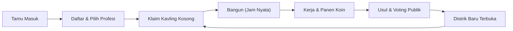

# Blueprint Game Kota Netizen (Republik Netizenia Pattern)

> **Dokumen Referensi**: Blueprint Game Kota Netizen v2 (@Ssfgf)  
> **Adaptasi Proyek**: AUDIRA-LAND  
> **Tanggal Registrasi**: 11 November 2026  

---

## 1. Ringkasan Eksekutif

Blueprint ini memecah sistem **Republik Netizenia v2** menjadi pola arsitektur yang modular dan *reusable*: **satu dunia bersama yang dibangun pelan-pelan oleh banyak pemain sungguhan**, berjalan di browser ponsel tanpa instalasi, dengan biaya server mendekati nol.

### Inti Mesin (Tetap Sama di Setiap Konsep):
1. **Dunia Bersama dan Persisten**: Semua pemain melihat peta yang sama secara sinkron, seluruh perubahan tersimpan di database.
2. **Lahan Terbatas**: Pemain mengklaim petak kavling, lalu mendirikan bangunan dengan waktu tunggu nyata (*real hours*).
3. **Ekonomi Sederhana**: Koin pemain, kas negara/kota, pajak, dan batas penghasilan harian (*daily cap*).
4. **Keputusan Bersama (Demokrasi Gotong Royong)**: Proyek infrastruktur publik besar diusulkan dan divoting dengan ambang suara (*quorum*) dan batas waktu.
5. **Dunia Hidup**: NPC berlalu-lalang, kendaraan melintas di lajur, siklus siang-malam mengikuti jam WIB nyata, serta props di trotoar.
6. **Mode Tokoh (Walk Mode)**: Pemain dapat menjelajahi dunia 3D sebagai avatar third-person, dilengkapi joystick, aksi, emote, dan balon chat.

### Kulit (Disesuaikan untuk AUDIRA-LAND):
- **Nama & Konsep**: AUDIRA-LAND (Metropolis Gotong Royong Digital).
- **Mata Uang**: Koin Audira (₳).
- **Arsitektur 3D**: Gaya Tinta Hangat (*Warm Ink*) perpaduan Rumah Tropis Nusantara, Warung, Ruko, dan Aksen Neo-Brutalisme / Cyber-Nusantara.

---

## 2. Loop Permainan dan Sistem Inti

1. **Masuk sebagai Tamu**: Menjelajahi kota, melihat NPC, bangunan, dan berita tanpa login (hanya mode baca).
2. **Daftar & Pilih Profesi**: Pedagang, Petani, Barista, Arsitek, Kurir, PNS, Seniman. Profesi menentukan gaya bermain dan sumber koin.
3. **Klaim Kavling Kosong**: Kavling berada di zona distrik yang sudah terbuka.
4. **Bangun**: Melewati tahap Sketsa ➔ Proyek (crane & pekerja) ➔ Selesai. Terdapat durasi jam bangun nyata dan opsi percepatan.
5. **Kerja**: Bekerja di bangunan warga lain atau fasilitas umum untuk mendapatkan gaji koin.
6. **Usulan & Voting**: Bangunan publik besar (Balai Kota, Rumah Sakit, Pasar Sentral, Masjid Agung, Taman Digital) divoting oleh warga.
7. **Pertumbuhan Kota**: Kas terkumpul dari pajak dan donasi membuka distrik baru pada cincin luar.

---

## 3. Arsitektur Teknis "Zero Server Cost"

- **Client**: Static Single-Page Application (HTML5 + Three.js r128 + CSS Variables), dihosting di CDN Cloudflare Pages.
- **Backend**: Supabase (PostgreSQL 15+, Supabase Auth, Row Level Security, Stored Procedures / RPC).
- **Prinsip Utama**: **Browser tidak pernah menulis tabel database secara langsung!** Semua tabel diamankan dengan RLS tanpa grant tulis untuk publik. Setiap mutasi data harus melalui fungsi PostgreSQL `SECURITY DEFINER` yang memvalidasi kepemilikan, saldo koin, dan mengunci baris dengan `SELECT ... FOR UPDATE`.

---

## 4. Metrik Target & Anggaran Performa Mobile (390px Baseline)

| Parameter | Target Standar | Keterangan |
| :--- | :--- | :--- |
| **Viewport Pengujian** | 390 px (iPhone / Android Mid-End) | CPU throttled 4x |
| **Ukuran JS Bundle** | ≤ 450 KB (≤ 150 KB gzip) | Terpisah dari HTML, cache immutable 1 tahun |
| **Draw Calls** | ≤ 100 draw calls | Penggabungan bangunan per chunk 8 × 8 petak |
| **Batas Segitiga HP** | ≤ 2.250 tris per model dekat | Menggunakan LOD `drawRange` |
| **Queue Bangun** | Jatah 8 ms per frame di HP | Mencegah frame freeze saat memuat distrik |
| **Target FPS** | Konstan 50–60 FPS | Fallback hemat otomatis jika FPS < 26 selama 150 frame |

